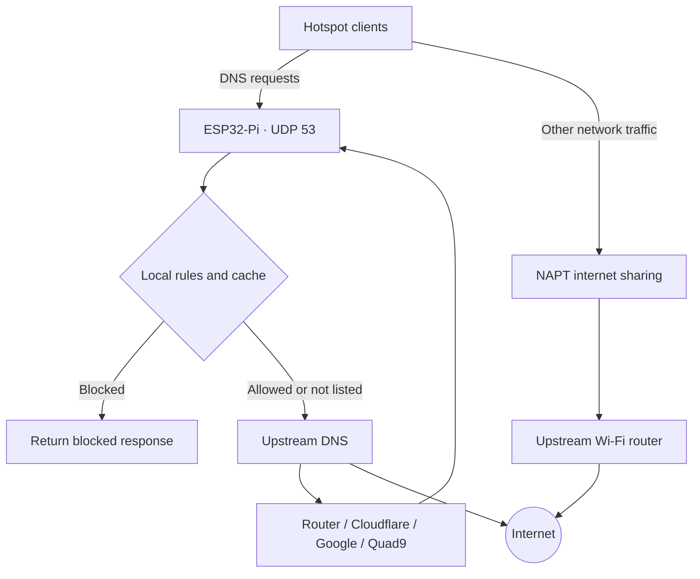

# ESP32-Pi

<p align="center"></p>

**A lightweight DNS-filtering gateway built for the ESP32-S3.** ESP32-Pi creates its own Wi-Fi hotspot, connects to an existing Wi-Fi network, shares that connection with hotspot clients, and filters DNS requests using local rules and the HaGeZi Pro domain blocklist. A built-in web dashboard lets you monitor traffic and manage the device without needing a separate server.

> ESP32-Pi is an ESP32-based DNS filtering project. It is not a Raspberry Pi, and it is not a drop-in replacement for the full Pi-hole software stack.

## Features

- **Wi-Fi access point and client mode:** Runs a local hotspot while connected to an upstream Wi-Fi network.
- **Internet sharing:** Enables NAPT when the upstream connection receives an IP address, allowing hotspot clients to use the internet through the ESP32.
- **DNS filtering:** Handles client DNS requests over UDP port `53` and blocks matching domains before forwarding other requests.
- **HaGeZi Pro blocklist:** Downloads the HaGeZi Pro list, stores it in flash, indexes supported domain rules in PSRAM, and can activate an updated list without rebooting.
- **Custom domain rules:** Add or remove domains from personal block and allow lists. Rules also apply to subdomains.
- **Allow-rule precedence:** Manual allow rules take priority over manual block rules, followed by HaGeZi exceptions and HaGeZi block rules.
- **DNS caching:** Uses a PSRAM cache with TTL aging, negative caching, and stale-answer support with background refresh.
- **Multiple upstream DNS providers:** Choose Router / ISP, Cloudflare, Google, or Quad9. The firmware maintains two upstream addresses for provider modes and can retry against the secondary server.
- **Optional AAAA suppression:** Skip IPv6 DNS lookups when hotspot clients do not have an IPv6 route.
- **Web dashboard:** View DNS traffic, blocked and cached requests, upstream latency, connected clients, Wi-Fi signal, memory use, storage use, and blocklist status.
- **Persistent configuration:** Stores saved Wi-Fi networks and DNS settings in Preferences, and domain lists and the downloaded blocklist in the FFat filesystem.
- **Task separation:** Runs the DNS worker independently from the web-server loop and pins background work to a CPU core to keep DNS processing responsive.

## How it works



The ESP32-S3 uses two Wi-Fi interfaces at the same time:

1. **Access point (AP):** Creates the network that client devices join. The default AP address and DNS address are `192.168.4.1`.
2. **Station (STA):** Connects to your existing Wi-Fi network. When this connection is available, the firmware enables NAPT so hotspot clients can access the internet.

DNS requests from hotspot clients are sent to the ESP32-Pi. The DNS worker checks the manual rules, the downloaded blocklist indexes, and the cache. Requests that are not blocked are forwarded to the selected upstream DNS service.

## Hardware requirements

The firmware is currently configured for this target:

| Component | Requirement |
|---|---|
| Board | ESP32-S3 N16R8 |
| Flash | 16 MB |
| PSRAM | 8 MB OPI PSRAM |
| Wi-Fi | 2.4 GHz 802.11 b/g/n-capable ESP32-S3 radio |

The HaGeZi indexes require PSRAM. The firmware allocates approximately 5 MB of PSRAM for the block and exception hash tables, in addition to the DNS cache and other runtime allocations. Boards without sufficient PSRAM may still run parts of the firmware, but the HaGeZi index will not be available.

The access point is configured for up to **four connected clients** by default.

## Software requirements

- Arduino framework for ESP32, **3.x**
- Arduino IDE or another build environment configured for the Arduino-ESP32 core
- A board definition and partition layout matching the ESP32-S3 module's flash and PSRAM

The firmware uses headers and facilities provided by the Arduino-ESP32 core, including `WiFi`, `Network`, `WebServer`, `Preferences`, `FFat`, `HTTPClient`, `WiFiClientSecure`, FreeRTOS, and ESP-IDF/lwIP APIs. No separate third-party Arduino library is required by the source files in this repository.

## Build and flash

### 1. Get the source

Clone the repository and keep the firmware and dashboard header in the same Arduino sketch directory:

```text
ESP32-Pi/
├── assets/
│   └── logo.svg   # Original project logo
├── code.ino
├── dashboard.h   # Dashboard with the logo embedded inline
└── README.md
```

Arduino sketches normally use a directory name matching the primary `.ino` file. If your IDE reports a sketch-name mismatch, either rename the directory to `code` or rename `code.ino` to match the sketch directory name (for example, `ESP32-Pi.ino`). Keep `dashboard.h` beside the `.ino` file.

### 2. Select the board and memory settings

Choose the board profile that matches your ESP32-S3 N16R8 module. For a generic ESP32-S3 module, **ESP32S3 Dev Module** may be an appropriate starting point, but verify the profile against your actual board.

Use the following firmware settings:

| Setting | Value |
|---|---|
| CPU frequency | 240 MHz |
| Flash size | 16 MB |
| Flash mode | QIO |
| Flash frequency | 80 MHz |
| PSRAM | OPI PSRAM |
| Core debug level | None recommended |
| USB CDC On Boot | Either setting is supported by the firmware |
| Partition layout | 16 MB layout with approximately 3 MB for the app and 9.9 MB for FFat |

**Important:** The partition table must contain an FFat-compatible data partition large enough for the downloaded blocklist. A different partition scheme may prevent the filesystem from mounting or leave insufficient space for the firmware's files.

### 3. Configure the credentials

Before flashing, edit the constants near the top of `code.ino`:

```cpp
static const char *AP_SSID = "ESP32_WiFi";
static constexpr char AP_PASSWORD[] = "esp32_wifi";

static const char *DASH_USER = "admin";
static const char *DASH_PASSWORD = "esp32_login";
```

Change all four values before using the device on a network you do not fully control. The hotspot password must be 8–63 characters.

### 4. Upload the firmware

Select the ESP32-S3's serial port and upload the sketch. Open the serial monitor at **115200 baud** to see startup messages, the hotspot address, DNS initialization, and connection diagnostics.

On startup, the firmware mounts FFat, loads saved settings and domain rules, initializes the DNS cache, starts the hotspot and web server, and launches the DNS worker. It attempts to load the HaGeZi index in a background task when a blocklist file is already present.

> The current firmware calls `FFat.begin(true)`. In the Arduino-ESP32 filesystem API, this enables formatting if the filesystem cannot be mounted. Do not rely on the FFat partition for unrelated files: a mount failure can result in that partition being reformatted.

## First-time setup

### 1. Connect to the ESP32-Pi hotspot

After boot, connect a phone or computer to the configured access point. With the source defaults, the network is:

| Setting | Default |
|---|---|
| Wi-Fi name (SSID) | `ESP32_WiFi` |
| Wi-Fi password | `esp32_wifi` |
| Device / DNS address | `192.168.4.1` |
| Dashboard | `http://192.168.4.1` |

### 2. Sign in to the dashboard

Open `http://192.168.4.1` and sign in using the dashboard credentials configured in `code.ino`. The source defaults are:

- Username: `admin`
- Password: `esp32_login`

The dashboard contains four sections:

- **Overview:** DNS query totals and categories, recent query activity, Wi-Fi status, hotspot clients, upstream status, memory, storage, and blocklist information.
- **Wi-Fi:** Scan for available networks, connect to an upstream network, and manage up to five saved networks.
- **Filters:** Update HaGeZi Pro and add or remove custom blocked and allowed domains.
- **Settings:** Select the upstream DNS provider, toggle AAAA suppression, clear the DNS cache, and restart the device.

### 3. Connect the ESP32-Pi to your router

Open **Wi-Fi**, scan for networks, select your network, enter its password, and choose **Connect and save**. A successful connection is saved so the firmware can try saved networks again after a disconnection or reboot.

When the station interface connects and receives an IP address, NAPT is enabled automatically. The dashboard's Overview page reports the station address and internet-sharing status.

Wi-Fi scanning temporarily takes the radio away from the hotspot, so connected clients may experience a brief interruption while a scan is running.

The current firmware also runs a one-time-per-boot throughput diagnostic after the upstream Wi-Fi connection is established. It downloads a 1 MB test file from `http://speedtest.tele2.net/1MB.zip` and prints the measured rate to the serial monitor. This creates external HTTP traffic automatically; remove the `linkTest()` call in `loop()` to disable it.

### 4. Update the blocklist

Open **Filters** and select **Download or update list**. The firmware downloads the HaGeZi Pro list, validates the downloaded file, installs it in FFat, and rebuilds the PSRAM indexes. A successful update becomes active without requiring a device restart.

An upstream Wi-Fi connection and enough free FFat storage are required. The firmware reserves space for a staged download and rejects downloads outside its configured size and validation limits.

## Using ESP32-Pi

### Filter devices connected to its hotspot

Devices connected to the ESP32-Pi hotspot receive `192.168.4.1` as their DNS server through the access point configuration. They can use the DNS filter without changing their individual DNS settings, provided they have not manually overridden the DNS server.

### Use it with an existing home network

The firmware can also act as a DNS filter for devices that remain connected to your normal router:

1. Connect ESP32-Pi to the router using the **Wi-Fi** dashboard.
2. Give the ESP32-Pi station interface a stable address. A DHCP reservation on the router is recommended.
3. In the router's DHCP/LAN settings, set the DNS server handed to clients to the ESP32-Pi station address shown on the Overview page.
4. Renew the DHCP lease or reconnect client devices so they receive the new DNS server.

This mode depends on the router allowing a custom DNS server to be advertised to its clients. Do not set the router's own upstream DNS to the ESP32-Pi address if doing so would create a forwarding loop; use the device's upstream DNS setting deliberately.

## DNS filtering details

### Rule sources and precedence

ESP32-Pi combines two manual lists with the supported portion of the HaGeZi Pro list. The lookup order is:

1. **Manual allowlist** — an allowed domain is not blocked by the following rules.
2. **Manual blocklist** — explicitly blocked domains are blocked.
3. **HaGeZi exceptions** — supported exception rules override the HaGeZi blocklist.
4. **HaGeZi blocklist** — matching domains are blocked.

A domain rule applies to the domain and its subdomains. For example, a rule for `example.com` also matches `ads.example.com`.

The initial manual blocklist contains a small set of ad and tracking domains; the initial allowlist contains `localhost`. Changes made through the dashboard are stored in FFat and survive a reboot while the filesystem remains intact.

### HaGeZi compatibility

The firmware does **not** implement the full browser-oriented Adblock rule language. Its parser extracts domain rules in forms such as:

```text
||example.com^
@@||example.com^
```

Cosmetic filters, regular expressions, URL paths, and other browser-only rules are ignored. The downloaded list is therefore used as a domain-level DNS blocklist, not as a full browser content-filtering engine.

### Upstream DNS options

| Provider | Servers |
|---|---|
| Cloudflare | `1.1.1.1`, `1.0.0.1` |
| Google | `8.8.8.8`, `8.8.4.4` |
| Quad9 | `9.9.9.9`, `149.112.112.112` |
| Router / ISP | DNS addresses learned by the ESP32 station interface, with a Cloudflare fallback when needed |

The DNS worker can keep multiple client queries in flight, retries using the secondary upstream, and records upstream response latency for the dashboard. The cache has 1,024 entries and uses response TTLs to age cached records. It can serve eligible stale responses while refreshing them in the background.

## Dashboard API

The built-in web server exposes these endpoints. They are intended for the dashboard and require HTTP Basic Authentication. State-changing `POST` requests also require the `X-ESP32Pi` request header.

| Method | Endpoint | Purpose |
|---|---|---|
| `GET` | `/api/status` | Device, Wi-Fi, DNS, memory, storage, and blocklist status |
| `GET` | `/api/scan` | Scan for nearby Wi-Fi networks |
| `POST` | `/api/connect` | Connect to and save an upstream Wi-Fi network |
| `GET` | `/api/saved` | List saved Wi-Fi network names |
| `POST` | `/api/forget` | Forget a saved Wi-Fi network |
| `GET` | `/api/domains` | Read the manual block and allow lists |
| `POST` | `/api/domain` | Add or remove a manual domain rule |
| `POST` | `/api/upstream` | Change the upstream DNS provider |
| `POST` | `/api/settings` | Update settings such as AAAA suppression |
| `POST` | `/api/cache/flush` | Clear the DNS cache |
| `POST` | `/api/blocklist/update` | Start a HaGeZi Pro download and update |
| `POST` | `/api/reboot` | Restart the device |

## Storage and configuration

| Data | Storage |
|---|---|
| Upstream DNS selection and AAAA setting | ESP32 Preferences (`esp32pi` namespace) |
| Up to five saved Wi-Fi credentials | ESP32 Preferences (`esp32pi` namespace) |
| Manual blocklist | FFat: `/blocked.txt` |
| Manual allowlist | FFat: `/allowed.txt` |
| Downloaded HaGeZi Pro list | FFat: `/hagezi-pro.txt` |
| Temporary and backup update files | FFat: `/hagezi-pro.tmp`, `/hagezi-pro.bak` |

The firmware's default access-point and dashboard credentials are compile-time constants in `code.ino`; they are not changed from the web dashboard.

## Security considerations

ESP32-Pi is intended for experimentation and trusted local networks. Review these limitations before relying on it:

- **The dashboard uses HTTP, not HTTPS.** HTTP Basic Authentication does not encrypt credentials. Anyone able to observe traffic on the local network may be able to recover them. Change the default credentials and do not expose the dashboard to an untrusted network or the public internet.
- **The blocklist download does not verify the TLS certificate.** The current firmware calls `WiFiClientSecure::setInsecure()`. The connection is encrypted, but the server certificate is not authenticated. A CA certificate or certificate bundle should be configured before treating downloaded lists as trusted.
- **Upstream DNS uses ordinary UDP DNS.** The firmware does not implement DNS-over-TLS or DNS-over-HTTPS.
- The custom request header on state-changing API calls is an additional cross-site request safeguard; it is not a substitute for HTTPS or strong network isolation.

## Current limitations

- DNS-over-TCP is not implemented. Responses that do not fit the firmware's supported UDP handling may fail.
- There is no IPv6 DNS server.
- AAAA query suppression is enabled by default and can be changed in Settings.
- HaGeZi support is limited to domain-based rules and exceptions; browser-only filtering rules are ignored.
- Blocklist updates are manual. There is no scheduled automatic update service.
- The access point is configured for up to four clients.
- The dashboard is served over plain HTTP.

## Branding

The original project mark is available as [`assets/logo.svg`](assets/logo.svg). The dashboard embeds the same SVG directly in `dashboard.h` for its header and browser favicon, so the device does not need to load a separate image file from FFat at runtime.

## Repository layout

```text
.
├── assets/
│   └── logo.svg   # Original project logo
├── code.ino       # ESP32-S3 firmware, DNS engine, Wi-Fi, APIs and setup
├── dashboard.h    # Embedded HTML/CSS/JavaScript dashboard and inline logo
└── README.md      # Project documentation
```

## Credits

- [HaGeZi DNS Blocklists](https://github.com/hagezi/dns-blocklists) — source of the HaGeZi Pro domain list used by the firmware.
- [Arduino-ESP32](https://github.com/espressif/arduino-esp32) — Arduino framework and ESP32 platform support.

## License

No license file is currently included in the supplied project files. Add a `LICENSE` file before publishing if you want to define how others may use, modify, and redistribute the code.
